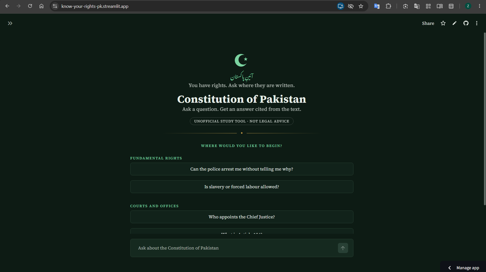
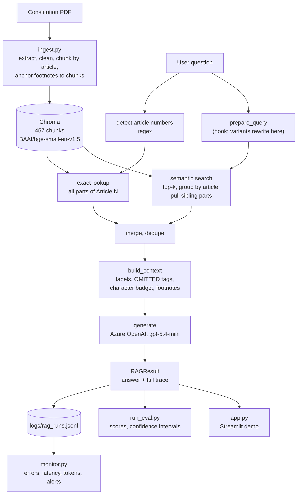
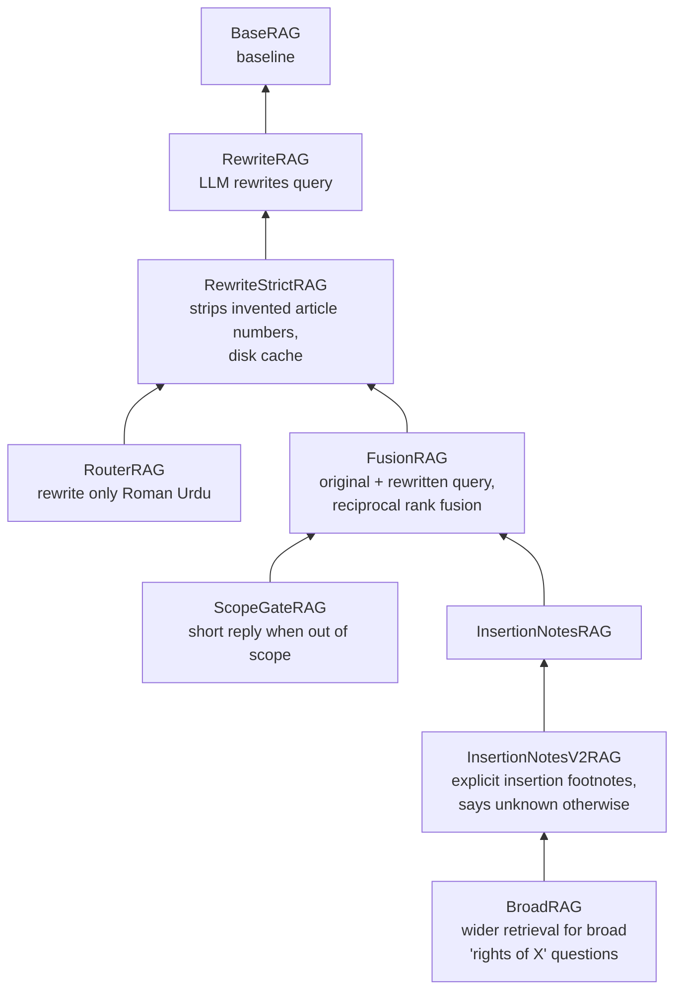

# Law_bot: RAG over the Constitution of Pakistan

A retrieval-augmented question-answering bot over the Constitution of Pakistan (as amended up to the 27th Amendment, 2025). It answers only from the retrieved text, cites article numbers and PDF pages, says when an article has been omitted, answers questions about how an article was inserted from the PDF's footnotes, and declines questions the Constitution does not cover.

> **Not legal advice.** This is an informational portfolio project. Answers can be incomplete or wrong. Check the official text.

## Live demo

**Try it:** https://know-your-rights-pk.streamlit.app/



*Ask in English or Roman Urdu. Each answer comes with the articles retrieved and cited. The demo is single-turn (no memory between questions), limits each session to 15 questions and the whole app to a daily total, and sends questions to Azure OpenAI.*

## Results at a glance

These are development numbers on small, hand-written question sets that were also used to design the system (see [Known limitations](#known-limitations)). They are not accuracy estimates.

| | Result |
|---|---|
| Correct article in the top 5 retrieved (fusion retrieval, 42 questions) | 0.98 (95% CI 0.88 to 1.00); baseline 0.92 on 39 questions |
| Questions answered correctly in a majority of 3 runs (`fusion_insertion_v2`, 29 questions) | 28/29 |
| Out-of-scope questions declined correctly (cryptocurrency, current office holders, tax rates, personal legal advice) | 4/4 in every run |
| Parsing bugs found and fixed through failure analysis | footnote text inside 33 chunks, 17 pages with no footnotes parsed, footnotes attached to the wrong article |

---

## Architecture



Every variant returns the same `RAGResult` (what was retrieved, what was cited, token usage, per-stage latency, the configuration used), so evaluation and monitoring work on any of them.

### Variants

Each variant overrides one stage of `BaseRAG` and inherits the rest.



| Variant | Stage it changes | What it targets |
|---|---|---|
| `base` | none | baseline |
| `strict` | query | vocabulary mismatch, Roman Urdu |
| `router` | query | Roman Urdu only, no extra latency elsewhere |
| `fusion` | retrieval | recall without hurting questions that were already fine |
| `fusion_scope` | generation | short, citation-free replies for out-of-scope questions |
| `fusion_insertion_v2` | context and prompt | "when was Article N inserted?" (**default**) |
| `broad` | retrieval limits | broad "rights of X" questions (not adopted, see below) |

---

## Data

- **457 chunks:** 417 article chunks, 3 preamble, 2 annex (Objectives Resolution), 35 schedule.
- Articles 1 to 280 plus lettered ones (327 distinct article numbers). 13 omitted articles are kept and tagged `omitted`.
- Each chunk carries a context header (Part, Chapter, Article title). Long articles are split (Article 175A has 9 parts), and sibling parts are re-attached at query time.
- Footnotes (amendment history) are stored as chunk metadata, not embedded. Each footnote is attached to the chunk that contains its marker (see below).
- Embeddings run locally (`bge-small-en-v1.5`). Only generation uses Azure OpenAI (model gpt-5.4-mini, version 2026-03-17).
- The prebuilt Chroma store (`chroma_db/`, about 7 MB) is committed so deployments don't re-ingest. Re-run `ingest.py` and commit the folder again if ingestion changes.

---

## Ingestion: footnote handling

Amendment questions exposed three ingestion problems. Each was found by tracing a wrong answer back to the PDF, and fixed in `ingest.py`.

1. **Footnote text leaked into article text.** On 17 pages the footnote separator was not detected (the dashes are rendered at 12pt on some pages, there is no dashed line on others, and one page uses a smaller footnote font), so those footnotes were never parsed and 33 chunks contained them. Footnotes parsed: 585 to 664.
2. **Footnotes were attached per page,** so a chunk carried its neighbours' notes. Article 11 carried Article 10A's insertion note, and Article 175A carried a note belonging to Article 175, which is why the baseline repeatedly answered "27th Amendment" for 175A. The extractor now records where each footnote marker appears, and attaches each note to the chunk that contains it. Chunks with notes: 385 to 238, and the 59 chunks with an article-level insertion note get it as `article_notes`.
3. **"ibid." lost its referent** once notes were separated by chunk ("New Article 140A ins. ibid."). It is now resolved at ingestion by appending the note it refers to.

Anchoring coverage: 768 markers, 624 resolved to a chunk. Of the 144 that are not, 107 point at cross-references ("See footnote 9 on page 5, supra") that are deliberately dropped, and 37 have footnote text but could not be matched (mostly repeal markers on rows with no text to match; they are left unattached rather than guessed). Anchoring is by text match, so a note's position inside a long article is approximate.

Chunk text and ids are unchanged apart from the 33 chunks that lost leaked footnote text. The count went from 463 to 457 because six trailing parts of long articles and schedules merged away. All 327 article numbers are still present (checked by comparing both stores).

The diagnostic scripts for this are in `tools/`. Run them from the repo root, for example `PYTHONPATH=. python tools/check_anchors.py constitution_of_Pakistan.pdf`.

---

## Evaluation

Run with `run_eval.py`. Raw results are in `eval/results/*.json` (each file records the model, temperature, store path and git commit). Questions are in `eval/questions.json`, tagged by split (`dev`, `heldout`, ...) and category. 55 questions: 49 with an expected article, 29 scored on answers (the rest have no expected facts).

### Retrieval

Is the expected article in the top 5 retrieved articles? 95% Wilson intervals.

| System | Store | n | hit@1 | hit@3 | hit@5 | Misses |
|---|---|---|---|---|---|---|
| base | old | 39 | 0.74 [0.59, 0.85] | 0.90 [0.76, 0.96] | 0.92 [0.80, 0.97] | q02, q11, q30 |
| fusion | old | 39 | 0.82 [0.67, 0.91] | 0.95 [0.83, 0.99] | 0.97 [0.87, 1.00] | q30 |
| fusion | new | 42 | 0.81 [0.67, 0.90] | 0.95 [0.84, 0.99] | 0.98 [0.88, 1.00] | q30 |
| broad | new | 49 | 0.84 [0.71, 0.91] | 0.96 [0.86, 0.99] | 0.98 [0.89, 1.00] | q30 |

"Old" is the store before the footnote fixes, "new" is the current default. The rows have different n because questions were added over time. The intervals overlap, so the baseline-to-fusion gain is a consistent direction and not a proven difference. Named-article questions get rank 1 from exact lookup, which inflates hit@1.

Earlier notebook comparison on 30 questions (expected article within top k):

| System | hit@1 | hit@3 | hit@5 |
|---|---|---|---|
| base | 20/30 | 26/30 | 27/30 |
| strict | 21/30 | 29/30 | 30/30 |
| router | 22/30 | 27/30 | 28/30 |
| fusion | 23/30 | 28/30 | 29/30 |

`fusion` was never worse than `base` on any of the 30. `strict` had the best recall but regressed on four questions, which `fusion` did not.

### Answers

3 runs per question, scored by an LLM judge against hand-written expected facts. A question passes a run only if every expected fact is stated. Out-of-scope questions pass only if the bot declines without answering from outside knowledge. Runs that hit an API error are excluded (0 in the tables below). Intervals are on questions passing in a majority of their runs.

| System | Store | Questions | Mean pass rate | Passing (majority of runs) | Failing |
|---|---|---|---|---|---|
| fusion | old | 26 | 0.78 | 20/26 [0.58, 0.89] | q01, q35, q38, q39, q41, q43 |
| fusion_insertion_v2 | old | 26 | 0.94 | 24/26 [0.76, 0.98] | q01, q35 |
| fusion | new | 29 | 0.85 | 25/29 [0.69, 0.95] | q01 (2/3), q35, q38, q39, q43 |
| fusion_insertion_v2 | new, before "ibid." fix | 29 | 0.84 | 24/29 [0.65, 0.92] | q01, q35, q39, q40 (1/3), q43 |
| **fusion_insertion_v2** | **new, current default** | 29 | **0.93** | **28/29 [0.83, 0.99]** | q01 (2/3), q04 (2/3), q35, q43 (2/3) |
| broad | new | 29 | 0.92 | 27/29 [0.78, 0.98] | q01 (0/3), q35, q43 (2/3) |

Reading the table:
- The question set grew from 26 to 29 between the stores, and a one-run difference is noise, so the old and new rows are not strictly comparable.
- The new store fixed the contamination at its source: the trap question "when was Article 11 inserted?" (whose page carries Article 10A's notes) passes with plain `fusion`, without any special extractor.
- Before the "ibid." fix, `fusion_insertion_v2` regressed on three questions (2A, 140A, and "when did 140A become part of the Constitution"). The cause was that "New Article 2A ins. ibid." no longer had the note it refers to in the same chunk. Resolving it at ingestion recovered them.
- q35 ("when was 175A inserted?") fails the strict all-facts rule because the answers give the correct origin (Act No. 10 of 2010) and don't mention the later 2024 and 2025 amendments, which the question did not ask for. The expected facts were left as written.
- q01 ("can the police arrest me without telling me why?") varies run to run in whether the 24-hour magistrate rule is mentioned. `broad` scored 0/3 on it and `fusion_insertion_v2` 2/3, but the two run identical code for that question (the broad trigger doesn't match it), so the gap is pure run-to-run noise.
- Plain `fusion` still fails questions phrased as "how did X come to be part of the Constitution": notes are only attached when the question matches an amendment keyword gate or names the article, and keyword gates are fragile.

Other answer-level results:
- **Out-of-scope** (cryptocurrency, current Prime Minister, income-tax rates, a personal divorce case): never in a failing list, in any variant tested.
- **Three fresh articles with provisos** (Articles 44, 175I, 147; 6 runs each, old store): the main fact and the proviso were stated 18/18 times with plain `fusion`. A prompt rule asking for exceptions made no measurable difference.
- **`fusion_scope`**: in a notebook check, no answerable question was flagged out of scope after one fix, and all four out-of-scope questions were flagged and got a short, citation-free reply. No answer-level `run_eval.py` run is recorded for it.

### Latency and cost

| Stage | Typical time |
|---|---|
| Query rewrite (one extra LLM call) | about 1.8 s |
| Retrieval | 0.04 to 1.1 s |
| Generation | about 1.4 to 2.4 s |
| Total (new question) | about 5 s |
| Prompt size | about 2.7K to 6.4K tokens |

The rewrite roughly doubles latency for a gain in retrieval. Evaluation logs understate latency (median about 1.3 s) because rewrites are cached to disk there. Use live runs of `ask.py` for real numbers. Per-token prices are not recorded in the repo, so cost is only computed if you pass them to `monitor.py`.

---

## What worked, what didn't

**Retrieval misses show up as confident but incomplete answers.** For "Can the government take my land?", the baseline never retrieved Article 24 (protection of property rights) and answered from Articles 23 and 152. The answer was grounded but incomplete, with no sign that the key article was missing. Query rewriting and fusion fix this.

**Rewriting helped, but it hallucinated article numbers.** The LLM added article numbers from memory ("article 41 42 43"), which steered the search wrongly on one question. A prompt instruction not to do so was ignored, so the fix was code: strip any article number the user did not type.

**The rewrite step is not deterministic**, even at temperature 0, so one early "regression" was partly sampling noise. Rewrites are now cached to disk for evaluation (delete `eval/rewrite_cache.json` if you change the rewrite prompt).

**Amendment history was limited by the data.** The first answers attributed an insertion to the wrong amendment because notes were page-level and unanchored.
- A prompt rule fit to Article 175A fixed it, then **regressed on Article 10A** (it picked up an unrelated 1975 note).
- A deterministic extractor for "New Article N ins." footnotes, plus an explicit "no insertion footnote found" signal, fixed both and the unseen cases tested, but covered only about ten articles.
- Anchoring footnotes at ingestion fixed the problem at its source (see Ingestion). The extractor now reads the anchored notes, and remains the fallback for articles whose notes don't use that wording.

**Broad questions get only the top 5 articles.** "What are the rights of minorities?" cites Article 36 and the Objectives Resolution but not Article 20 (freedom of religion), which sits at rank 12 in the retrieved list. `BroadRAG` widens retrieval for "rights of X" / "tell me about X" questions that name no article. On seven probe questions it improved retrieval recall for one (Article 20 for minorities) while using 2 to 3 times the context. In a 4-run answer check, Article 20 was cited in 1 of 4 answers (0 of 4 with the default), at about 2.7 times the tokens (2,987 vs 1,118) and more than twice the words. It matched the default on the regression run, but the gain was too small for the cost, so it is a documented variant and not the default.

**A bug in my own harness.** The first answer-level runs counted rate-limit errors (HTTP 429) as wrong answers. Those numbers were discarded. The client now retries (`max_retries=8`), and the harness excludes errored runs and reports how many there were.

**Negative results:**
- A scope rule inside the answer prompt made decline replies shorter, but in the one answer inspected it also shortened a normal answer (the arrest question lost the 24-hour rule). The evidence is weak, because those runs were noisy and some were rate-limited. A separate scope check (`fusion_scope`) avoids touching the answer prompt, at the cost of one extra call per question and a fixed decline message.
- A prompt rule asking for exceptions and provisos made no measurable difference.
- An LLM scope gate wrongly declined a valid question ("Article 19 gives freedom of religion, right?") until a deterministic rule was added: a question that names an article is always in scope.

---

## Monitoring

Every run is logged as one JSON line: variant, model, detected and retrieved articles, cited articles, token usage, per-stage timings, configuration and error. Evaluation runs write to `logs/eval_runs.jsonl` and real usage to `logs/rag_runs.jsonl`. The retrieved context is not stored by default (the chunk ids are, so it can be rebuilt); pass `log_context=True` to `BaseRAG` to keep it.

```bash
python monitor.py --log logs/rag_runs.jsonl
python monitor.py --log logs/eval_runs.jsonl --last 200
python monitor.py --log logs/rag_runs.jsonl --price-in <usd per 1M> --price-out <usd per 1M>
```

Per variant and model it reports error rate and error types, latency percentiles (total and generation), prompt and completion tokens (and cost if prices are given), answers with no citations, citations of articles that were not retrieved, context-budget drops, and questions about missing articles. It prints alerts when the error rate exceeds 5%, p95 latency exceeds 10 s, or more than 10% of answers cite an unretrieved article. Thresholds are constants at the top of `monitor.py`.

`cited_not_retrieved` is a rough flag, not a hallucination metric: an article can be mentioned inside a source (Article 49's text refers to Article 41), and the model repeats it.

On a hosted deployment the log lives on the host's disk and should be treated as per-session, so monitoring is meant for local and evaluation runs.

---

## Known limitations

- **Small, hand-written evaluation sets** (55 questions), used while designing the variants, so the held-out splits are no longer clean. Treat the numbers as development indicators, not accuracy estimates.
- **Many expected articles and facts were written from general knowledge and spot-checked against the text**, not independently verified. `"verified": true` marks the ones checked.
- **The LLM judge is the same model that writes the answers**, and it was lenient on some wrong amendment answers. Judged results are probably slightly optimistic.
- **Named-article questions inflate retrieval metrics**, because exact lookup puts the article at rank 1.
- **Answers vary run to run even at temperature 0**, so single-question comparisons are unreliable and differences of one run are noise.
- **Broad "rights of X" questions can miss related articles** that rank below the top 5 (see above).
- **Footnote anchoring is approximate:** 37 markers with footnote text are unanchored, positions inside long articles are matched by text, notes are capped at 2,000 characters per chunk, and a wrapped footnote line can lose a space ("aconsequence"). The insertion extractor only recognises "New Article N ins." wording, so it covers about 60 chunks, and the bot says the sources don't state the rest.
- **Style:** answers sometimes end with an unrequested offer ("If you want, I can also summarize..."), and decline replies for in-scope questions the sources can't answer list loosely related articles.
- **Retrieval for named-article questions pulls in semantic neighbours** that add tokens and noise (Article 175A's insertion question uses about 6.4K prompt tokens).
- **The demo is single-turn:** each question is independent, so follow-ups like "tell me more about that" don't work.
- Roman Urdu depends on the rewrite step. The embedding model is English-only.
- The 27th Amendment text is treated as current law. There is no support for earlier versions.

---

## Run it

```bash
python -m venv .venv
source .venv/bin/activate
pip install --upgrade pip
pip install -r requirements.txt          # pipeline and app (CPU-only torch)
pip install -r requirements-dev.txt      # only needed for the notebooks
cp .env.example .env                     # add your Azure OpenAI values

python ask.py "Can the police arrest me without telling me why?" --trace
python ask.py                            # interactive
streamlit run app.py                     # web demo

python run_eval.py --system fusion                           # retrieval only, free
python run_eval.py --system fusion_insertion_v2 --answers --runs 3
python run_eval.py --system fusion --db-path ./other_store   # compare two ingests

python monitor.py --log logs/rag_runs.jsonl
```

`chroma_db/` is already built. To rebuild it (only needed if you change ingestion), run `python ingest.py constitution_of_Pakistan.pdf --reset` and commit the folder.

`.env` needs `AZURE_OPENAI_ENDPOINT`, `AZURE_OPENAI_API_KEY`, `AZURE_OPENAI_DEPLOYMENT`, and optionally `TEMPERATURE` and `MAX_OUTPUT_TOKENS`. The endpoint is the Azure OpenAI one (`...openai.azure.com` or `...services.ai.azure.com`), not the Foundry project or agent URL; the code keeps only scheme and host. Swapping the model is the one `AZURE_OPENAI_DEPLOYMENT` line.

### Deploy it (Streamlit Community Cloud)

1. Push the repo to GitHub (the committed `chroma_db/` means no ingestion on the host).
2. At share.streamlit.io choose the repo, branch `main`, main file `app.py`, and the highest Python version offered.
3. Paste the secrets as TOML, with every value quoted:
   ```toml
   AZURE_OPENAI_ENDPOINT = "https://<your-resource>.openai.azure.com"
   AZURE_OPENAI_API_KEY = "<key>"
   AZURE_OPENAI_DEPLOYMENT = "<your deployment name>"
   TEMPERATURE = "0"
   MAX_OUTPUT_TOKENS = "1200"
   DAILY_QUESTION_LIMIT = "150"
   ```

Notes for a public deployment:
- Measured locally, the app uses about 0.9 GB of memory once the model is loaded. Check the host's current limits.
- The first request after a restart is slow because the embedding model loads.
- Every visitor question calls your Azure deployment. The app limits each session and the whole app per day, but keep a low tokens-per-minute cap on the deployment and set a budget alert.
- Questions are sent to Azure OpenAI and logged on the server.

### Layout

```
app.py             Streamlit demo
ingest.py          PDF -> chunks (footnotes anchored) -> Chroma
store.py           VectorStore (Chroma, local bge embeddings)
config.py          settings, Azure OpenAI client (retries on rate limits)
base_rag.py        BaseRAG pipeline, RAGResult trace
variants.py        rewrite, router, fusion, scope gate, insertion-notes, broad variants
evaluation.py      retrieval and answer scoring, LLM judge
run_eval.py        one command to score a variant, saves a report
monitor.py         summarises a run log: errors, latency, tokens, alerts
ask.py             command-line entry point
tools/             diagnostics for the footnote work (run with PYTHONPATH=.)
eval/              questions.json, results/, rewrite_cache.json
chroma_db/         prebuilt vector store (committed)
docs/              demo screenshot
logs/              run logs (git-ignored)
constitution_of_Pakistan.pdf   source document
.env.example       required settings
```

`logs/` and `.env` are git-ignored.

---

## Next steps

- A larger evaluation set written and checked independently of the system, with a different model as judge and a human review of a sample.
- Skip semantic search when an exact lookup already answers a named-article question, to cut tokens and noise.
- Anchor the 37 remaining footnote markers, and handle article insertions that don't use the "New Article N ins." wording.
- Conversation memory for follow-up questions.

Built by [Zimran Sohail]([https://www.linkedin.com/in/zimransohail/]).
